# InsightIQ

## Your data, actually understood.

InsightIQ is an AI-assisted analytics workspace that turns raw datasets, documents, images, videos, and public links into useful, explainable answers.

It combines a deterministic analytics engine with an evidence-grounded AI layer:

- **The analytics engine computes the numbers.**
- **The AI layer explains the verified results.**
- **The interface keeps the workflow visible from upload to insight.**

No mocked dashboards. No unexplained numbers. Upload your data, understand what is inside it, improve its quality, compare versions, and ask questions in plain language.

---

## See InsightIQ in action

### One workspace for the complete data workflow

#### Upload

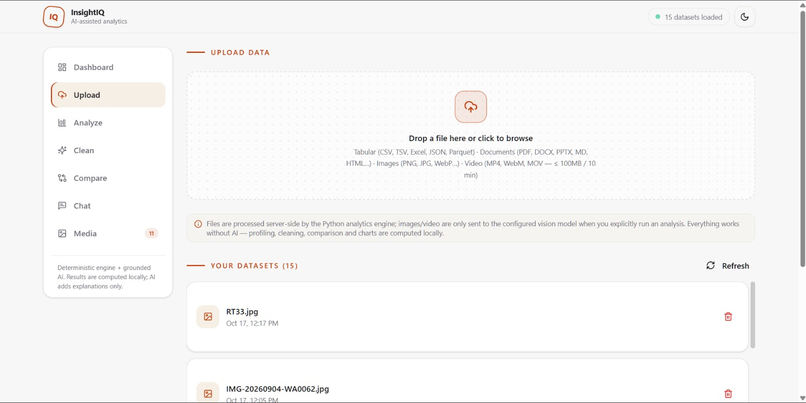

#### Analyze

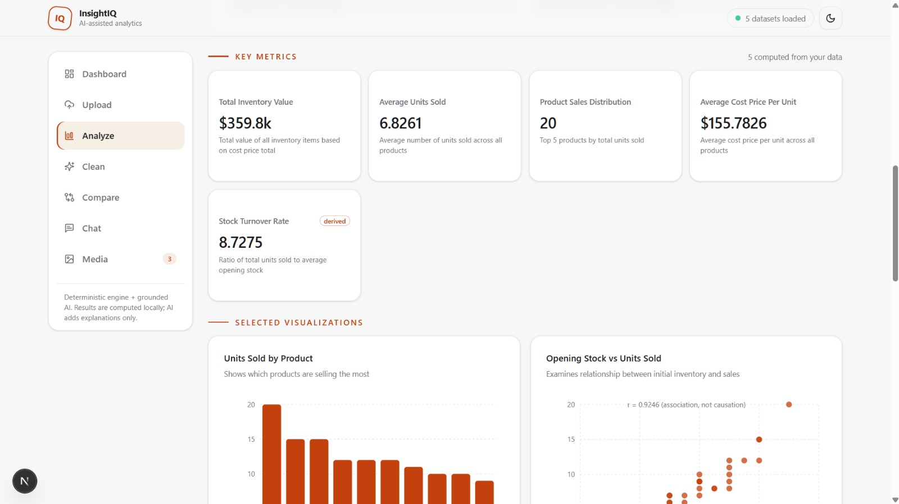

#### Clean

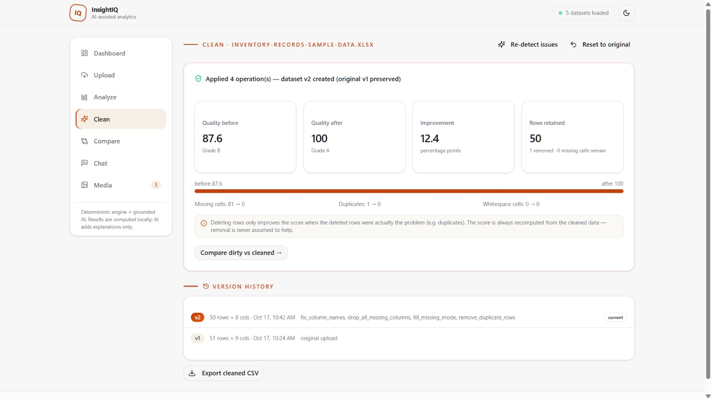

#### Compare

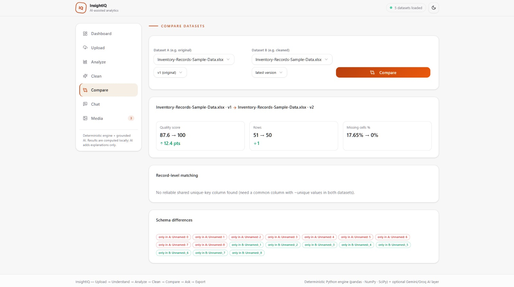

#### Ask

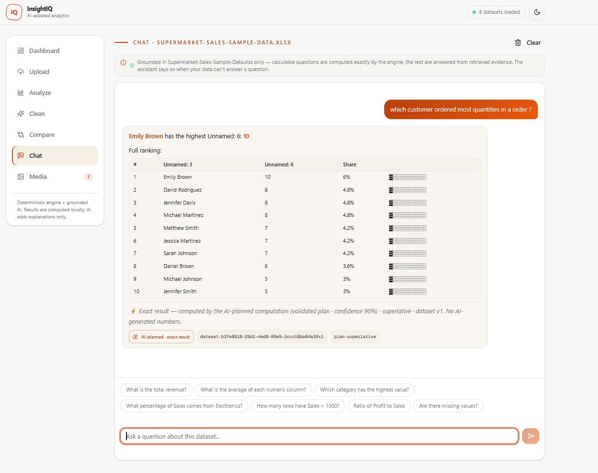

### Analysis that goes beyond a chart

InsightIQ profiles the data, selects useful KPIs and visualizations, validates findings, and presents the evidence behind the result.

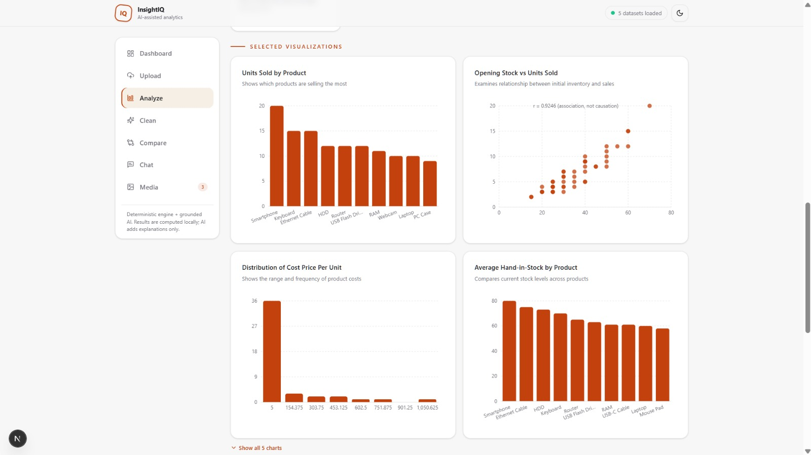

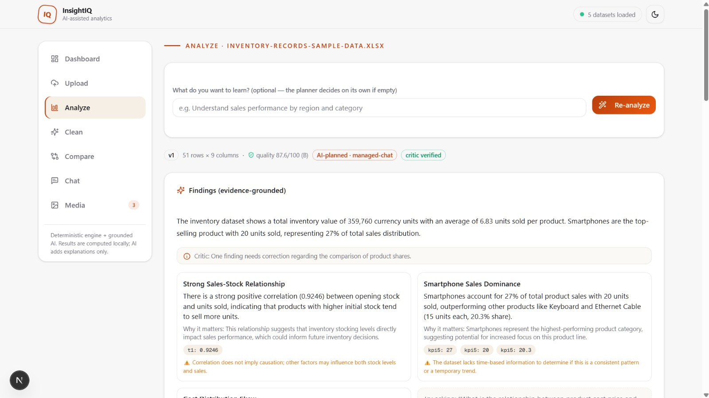

### Cleaning with control and history

Review suggested operations before applying them. Every cleaning action creates a new dataset version, so the original remains available and changes can be audited or reset.

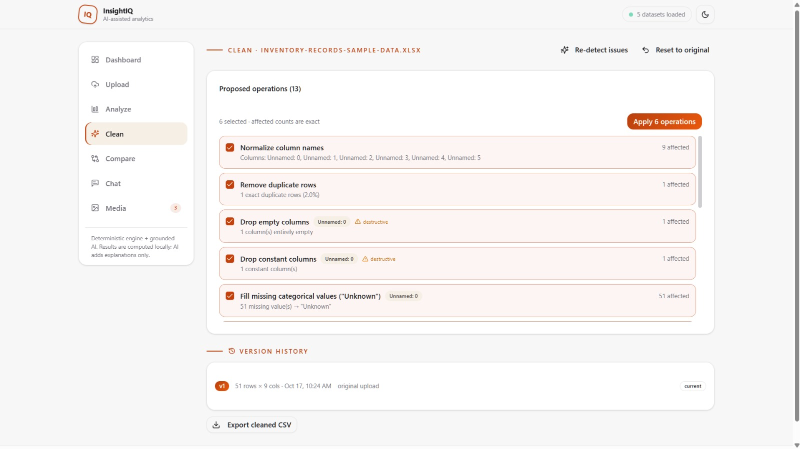


### Compare real dataset versions

Compare original and cleaned data, or compare any two tabular datasets, with measurable deltas instead of guesswork.


### Ask questions with grounded answers

The chat experience answers from the selected dataset or document. Numeric questions use deterministic aggregations, document questions retrieve relevant chunks, and unsupported questions are not presented as facts.


---

## What you can do

### Upload and profile

Upload tabular data, documents, images, and videos from one place. Supported inputs include:

- CSV, TSV, TXT, JSON, JSONL, NDJSON
- Excel, ODS, and Parquet
- PDF, DOCX, PPTX, ODT, RTF, Markdown, HTML, and XML
- PNG, JPG, JPEG, WEBP, GIF, and BMP
- MP4, WEBM, MOV, MKV, and AVI

Files are profiled after upload so you can quickly see what is ready to analyze.

### Analyze

- Deterministic profiling and descriptive statistics
- KPI cards and data-driven charts
- Findings tied back to the uploaded data
- Document structure, summaries, page counts, and searchable chunks
- Exportable analysis results and reports

### Clean safely

- Detect missing values, duplicates, type issues, and quality problems
- Preview the exact operations and affected row counts
- Approve only the changes you want
- Preserve the original dataset
- Keep version history and reset to the original when needed

### Compare

- Compare two datasets or two versions of the same dataset
- Inspect row, column, quality, and metric changes
- Use original-versus-cleaned comparisons to validate improvements

### Understand images, videos, and links

- Image descriptions, objects, OCR, and visual questions
- Video frame sampling, timeline context, and transcripts when available
- Public YouTube metadata and public web-page extraction
- Direct image and video URL analysis

The media workspace only sends files to the configured vision model when analysis is explicitly requested.

### Chat with evidence

Ask natural-language questions about datasets, documents, and media. Answers are grounded in the selected file, with sources shown where available. When the data cannot answer a question, InsightIQ says so.

---

## Media demos

The repository includes captured examples of the current product experience. Images are embedded individually so GitHub renders them as direct previews instead of relying on a table layout.

### Product workflow

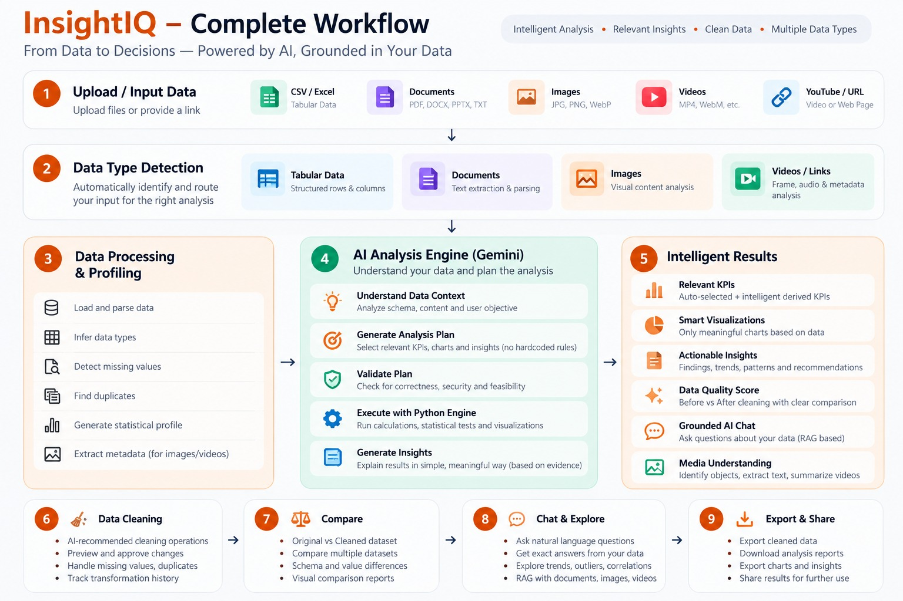

### Analysis


### Data cleaning


### Image understanding


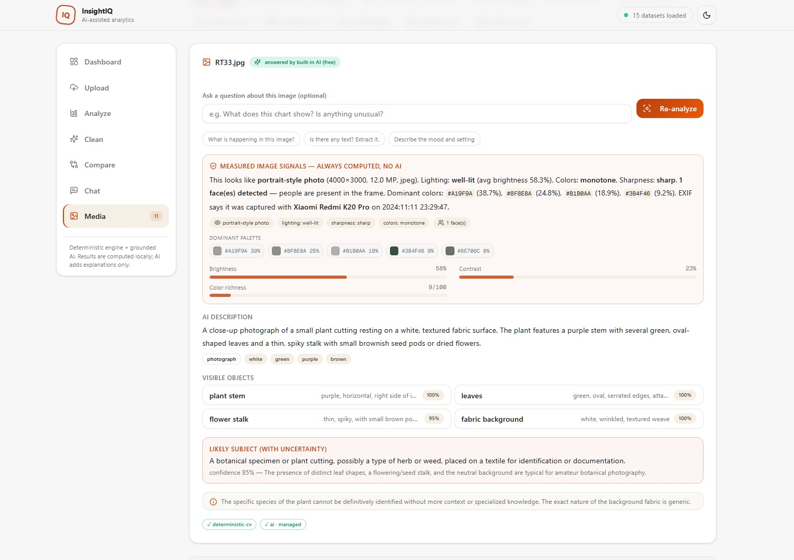

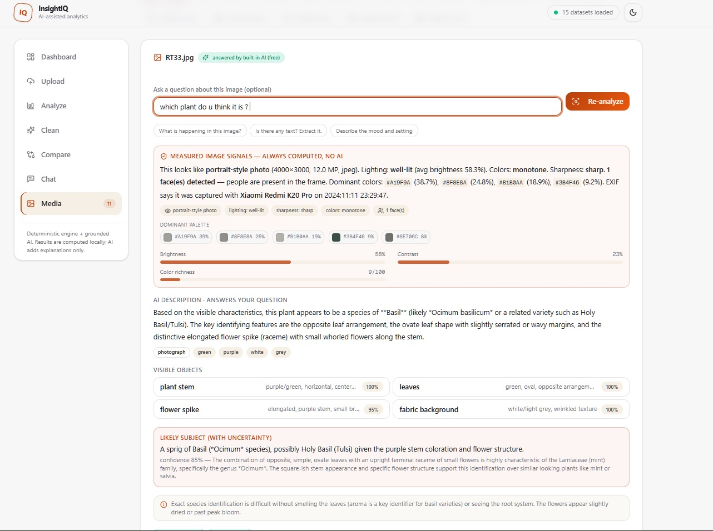

### YouTube and link analysis

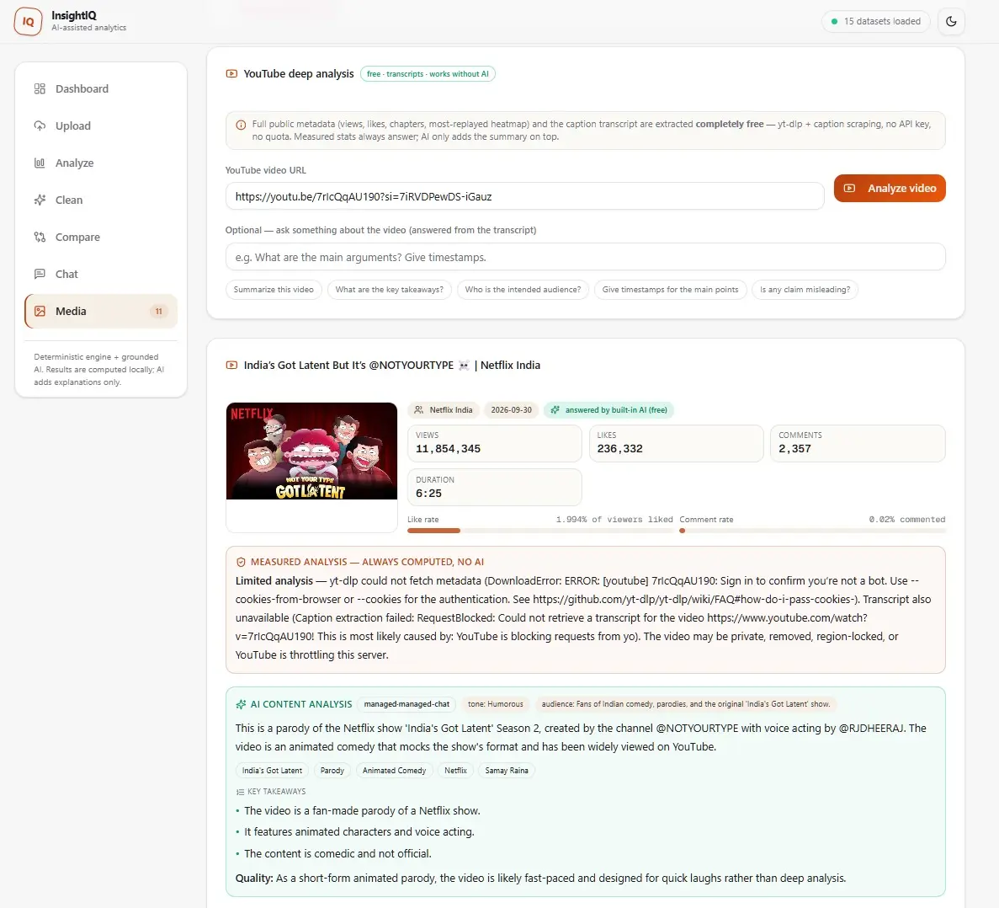

### Video recordings

#### Hills scenery input

<video controls width="100%">
  <source src="https://github.com/user-attachments/assets/5483c022-976b-4daf-832e-d1b101876e45" type="video/mp4">
</video>

#### Hills scenery analysis output

<video controls width="100%">
  <source src="https://github.com/user-attachments/assets/add6dfe0-8ce0-40a4-b379-08ec5770ffb4" type="video/mp4">
</video>


#### The DWBI recording input:

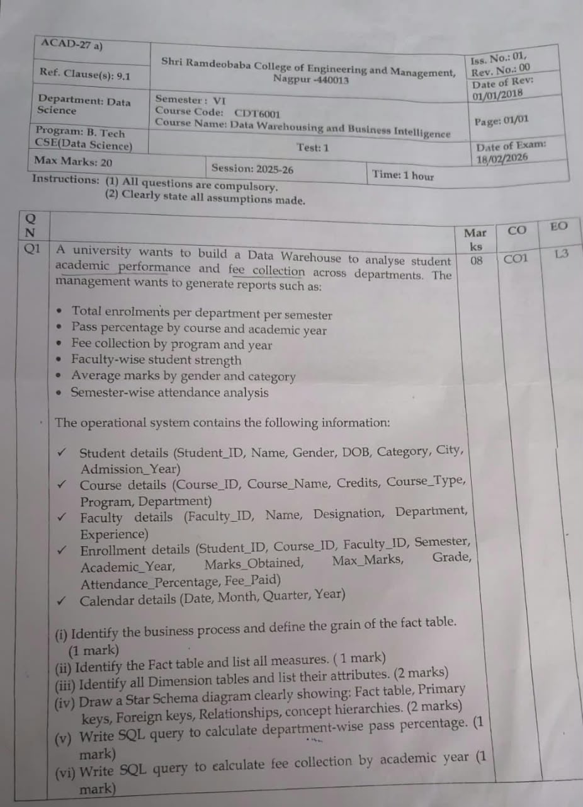


#### DWBI question analysis output

<video controls width="100%">
  <source src="https://github.com/user-attachments/assets/1d7b732c-23d1-4271-a5d1-461b69755cb1" type="video/mp4">
</video>


---

## How it works

```text
Upload
  ↓
Profile locally
  ↓
Analyze with deterministic statistics
  ↓
Explain with grounded AI
  ↓
Clean with approval and version history
  ↓
Compare measurable changes
  ↓
Ask follow-up questions
```

The frontend is a responsive Next.js application. The backend combines an Express service with a Python analytics engine built around pandas, NumPy, and SciPy. Optional Gemini/Groq providers add explanations and media understanding while the application keeps the source data and API keys behind the backend.

---

## Run locally

### Frontend

```bash
npm install
npm run dev
```

The frontend runs on [http://localhost:3000](http://localhost:3000).

### Backend

```bash
cd mini-services/insightai-backend
npm install
pip install -r requirements.txt
npm run dev
```

The backend requires Node.js 18 or newer and Python with the packages listed in `mini-services/insightai-backend/requirements.txt`.

Configure the backend environment with the provider keys and service settings required for your deployment. Keep secrets server-side and never commit them to the repository.

---

## Built with

- Next.js, React, TypeScript, and Tailwind CSS
- Express and Node.js
- Python, pandas, NumPy, and SciPy
- Prisma and SQLite
- Recharts for data visualizations
- Optional Gemini/Groq AI providers

## Project status

InsightIQ is an active product build focused on trustworthy, explainable analytics for mixed data types. The screenshots and recordings in [`media/`](./media/) show the current product experience across the main workflows.
